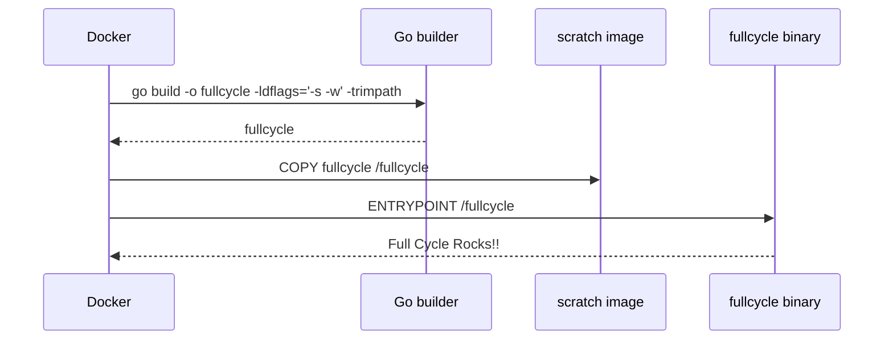

# fullcycle-docker-challenge

Docker image name: `fullcycle-go`



Aplicação Go mínima para o desafio Full Cycle Docker.

## Resultado esperado

Ao executar o container, a saída deve ser:

```bash
Full Cycle Rocks!!
```

## Build e execução local

```bash
docker build -t fullcycle-go .
docker run --rm fullcycle-go
```

## Imagem no Docker Hub

Publique a imagem com o comando abaixo:

```bash
docker tag fullcycle-go julianepires/fullcycle-go:latest
docker push julianepires/fullcycle-go:latest
```

Execução esperada pelo avaliador:

```bash
docker run julianepires/fullcycle-go:latest
```
